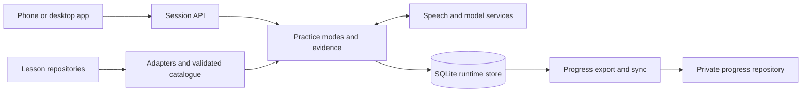

# Production plan

Date: 2026-10-16. Status: proposal for discussion, before implementation.

Build a language practice app that connects to a configurable server, selects
lessons from independent repositories, offers repetition, guided conversation
and free conversation, and preserves personal progress separately from content.
Keep the product code in `voice-teacher`; evolve the working engine into an
application outside `pocs/`.

Working assumptions: personal use first, Android and desktop through an
installable web app, Git repositories for content and private progress, and
one active server writing progress. These are proposed defaults, not settled
requirements. The server initially runs on the learner's computer; speech and
language-model services still need an internet connection.

## What the project already establishes

The purpose is spoken reactivation of a previously learned language, initially
Ukrainian. Its distinguishing features are controlled practice, help offered in
stages, observable evidence, and a repetition queue that preserves source
history. Progress describes what was practised and with how much help; it does
not claim mastery or infer pronunciation from a transcript.

POCs 0–2 established the need to own the voice loop and tested recognition and
stress-sensitive synthesis. POC 5 now has a typed tutor, an Android web client,
speech adapters, audio caching, structured judging, and real voice lessons.
Its 53 tests pass locally as of this review. POCs 3 and 4 have no implementation
directories: a durable store and automatic adherence evaluation remain work.

The two Android runs on October 2 and 5 found that speaking the English task
helped guided practice, and a roughly 50-turn lesson was too long. The engine
now supports two sittings. Run 2 recorded a median server turnaround of 2.59 s
for judged turns and 0.99 s for repetition with a warm cache. These measurements
exclude upload time and playback startup. The evidence supports a product
build, while learning effectiveness across lessons and long-term retention
remain unestablished. See the [POC 5 results](../pocs/05-session-engine/README.md).

The main production gaps are concrete:

- A single lesson and session live in server memory. Logs are saved at the end,
  on stop, or when replaced; restarting can lose an active session.
- The lesson is selected at server startup. There is no source catalogue or
  app-level mode selector.
- The lesson schema embeds a learner profile and assumes Ukrainian and English.
  Source identity is a package-folder string, and phrases lack stable item IDs.
- Synthesis can fail after the engine advances, losing delivery of that turn.
  Requests have no durable identifier for safe retry after a lost response.
- Access uses a secret URL. The current speech adapter returns text and duration,
  not confidence, despite older architecture notes proposing confidence rules.
- The model judges answers; most teacher speech comes from code. Free
  conversation requires dialogue generation and separate evaluation.

## Repository boundaries

| Responsibility | Proposed location | Access from the server |
| --- | --- | --- |
| App, API, engine, schemas, adapters, tests, deployment | This `voice-teacher` repository | Application code |
| Curriculum and reusable lesson packages | One or more lesson repositories; initially `learnukrainian` | Read content |
| Vocabulary material | `ukrainian-vocabulary`, through a separate adapter later | Read content |
| Learner profile, practice events, corrections, progress exports | A configured private progress repository | Write only the app's namespace |
| Live database, source cache, generated audio, optional recordings | Server data directory outside code/content checkouts | Local persistent storage |

`language-learning-data` is a candidate for progress because it already holds
private review events. Use a new `voice-teacher/` namespace without altering its
existing card-review format. A dedicated private `voice-teacher-progress`
repository is equally supported by configuration. Verify privacy and ownership
before enabling remote sync.

Keep this code repository: it already has relevant history, tests and a suitable
name. Separate app and server directories provide development boundaries
without requiring independent repositories. A new product repository is useful
only if ownership, release policy or visibility actually needs to differ.

`learnukrainian` currently mixes material and personal records. Read its lessons
through a compatibility adapter initially. Route new app records to the progress
store; migrate historical progress through an explicit import. Keep the old
records intact during verification. Extracting a clean curriculum repository
can follow independently; removing files later does not remove Git history.

## Learner experience and practice modes

The first-run setup pairs the app with a server and learner profile. Server
settings register lesson sources and the private progress destination. Daily
use is: choose source → course → lesson or topic → mode → start or resume.
The app remembers the selection and shows source-specific position and recent
practice. A repository may contain several courses with independent sequences.

| Mode | Behaviour | Progress evidence |
| --- | --- | --- |
| Repetition | Review a selected lesson's phrases or a short set of earlier weak items. Start with listen-and-repeat; optionally test recall before playing the answer. | Repeated, modelled, or needs another turn; independent recall only when an uncued attempt was actually recorded |
| Guided conversation | A scenario with explicit goals, optional task cards and spoken instructions, gradual help, then optional recall. | Independent use, cued use, corrected and repeated, modelled and repeated, skipped goals |
| Free conversation | Open dialogue at the learner's level; an optional lesson/topic provides context. Choose light immediate correction or feedback after the conversation. | Observed use and supported corrections, with turn references; no automatic completion of an entire course unit |

Repetition and guided practice should run independently, with an optional
combined routine preserving today's successful sequence. Duration presets
should favour about 5–10 minutes; stop, pause, replay, and later continuation
must work in every mode. The existing two-sitting split maps to saved activities,
not a server command-line option the learner must understand.

Free conversation can start without a lesson. Known curriculum items can be
linked when supported by evidence; new expressions remain personal observations
until deliberately promoted to a review target. Lesson availability describes
supported modes so a vocabulary-only source does not pretend to have a guided
scenario. Curriculum supplies content and goals; reusable teaching policy lives
in the engine. Personal weak items are selected into a private session plan.

Switching sources does not change a running session. Pause or finish it, then
start another; resuming uses its original content snapshot. Switching the
progress destination is a separate profile/configuration action and must never
silently mix learners or histories.

## Application architecture



Use a modular Python server, keeping the state machine separate from HTTP,
storage and providers. FastAPI is a reasonable extension of the existing
Starlette implementation for typed API contracts; retaining Starlette is also
viable. Use a TypeScript web client, with React as a proposed UI default, to
support the catalogue, session screen, history and settings. Serve the built
client and API from the same origin initially. A future native client uses the
same API.

Suggested layout:

```text
apps/web/                    app and microphone/playback handling
server/voice_teacher/
  api/                       versioned endpoints and authentication
  content/                   source registry, adapters, validation
  practice/                  repetition, guided and free policies
  providers/                 speech recognition, synthesis, judging, dialogue
  storage/                   database, migrations, recovery
  progress/                  evidence projections, export, Git sync
schemas/                     curriculum and progress format versions
tests/                       unit, integration and browser checks
deploy/                      local service and container configuration
pocs/                        retained experiments and benchmark evidence
```

Port the tested state transitions, correction rules, normalization, stress
handling, provider interfaces and fixtures. Replace the global in-memory
session service and inline client as their responsibilities move. Generalize
language and instruction language through profiles. Keep provider/model choices
configurable and record their versions. Existing provider choices are measured
baselines, not permanent requirements or current price quotations.

Start with turn-based audio upload and replayable teacher responses. A job and
event endpoint can expose recognition, judging and synthesis status; streamed
audio can follow if phone measurements justify it. WebSockets are optional for
the first release. Keep fixed speech cached/prepared. Expand the cache key to
include voice settings, output format and pronunciation rules.

## Lesson source contract

A registered source has a local checkout or Git remote, allowed subdirectory,
branch/tag, adapter type and display name. Support configured local paths
first, then server-managed Git clones and refresh. The app selects registered
sources; repository credentials and filesystem paths stay on the server.

Define a versioned manifest, such as `voice-teacher.json`, describing the
catalogue ID, language, courses, lesson paths and available modes. Lesson
packages need stable course, lesson, step and item IDs, display and speech
renderings, goals, repetition items, guided steps, expected outcomes, acceptable
targets and recall prompts. They must not contain a personal learner profile
or personal progress. The initial Markdown adapter reads existing packages;
new content can use validated JSON directly.

Identity includes catalogue namespace and course, so `4B` in two repositories
cannot collide. Record the source's exact commit, lesson hash, schema version
and a private compiled snapshot in each session. Local uncommitted content
needs an explicit snapshot/hash rather than being mistaken for committed data.
Item identities survive spelling corrections; substantial meaning changes
require a new version or explicit mapping. Never merge items solely by text.

Validate updates before activation, retain the last working revision, and pin
active sessions. Repository material is data: do not execute repository scripts
or let content grant tools or overwrite system instructions. Target answers
are available to post-attempt judging and intentional modelling, while the
pre-attempt dialogue generator must not receive them.

## Durable progress and Git synchronization

SQLite is the live transactional store for the first single-server release.
Persist the input, accepted transcript, evidence, resulting state and planned
teacher response as work proceeds. External calls occur outside database
transactions; durable stages allow recovery after a crash.

Each client turn has a unique request ID and expected session revision. Retries
return the recorded result or resume unfinished processing without adding
duplicate evidence. Serialize turns per session, enforce ownership inside the
transaction, and reject stale requests. If synthesis fails after judging,
retry the saved teacher response without advancing again. A refresh or server
restart restores the pending turn, phase, help state and next activity.

Store learners, source revisions, session snapshots, activities, turns,
observations, corrections, evidence and sync jobs. Each event carries a stable
ID, sequence, timestamp, learner/session, mode, source revision and relevant
item/turn references. Preserve original source and subsequent practice source
for shared review targets. Keep suspected recognition problems distinct from
supported learner corrections. Change a disputed observation through a new
superseding event.

After each committed turn, a transactional outbox schedules export. Export
immutable batches under `voice-teacher/events/<learner>/<session>/<batch>.jsonl`
and generate readable session/progress views. Stable IDs make imports and
retries idempotent. Prefer distinct batch files over one shared monthly append
file to reduce conflicts. Mutable summaries are derived and regenerable;
session state events and private snapshots must support reconstruction after
export, including interrupted sessions.

The database is authoritative for locally accepted work; Git holds the portable
archive of exported events. Show separate states for saved locally, exported,
and pushed, plus the last successful sync. A pending export is safe locally
but is not yet backed up remotely. Retry failures independently of teaching.
Use a dedicated app-managed checkout, stage exact app-owned paths, and never
force-push or resolve conflicts by dropping events. Import/deduplicate remote
events; a conflicting event ID with different contents requires intervention.
Start with one writer server; concurrent writers and moving between servers
need an explicit sync/handoff protocol before support is claimed.

Keep the database binary, keys, cache and raw audio out of Git. Retained learner
audio is optional, private, and stored separately with a retention policy.
The progress repository itself contains sensitive transcripts and snapshots.
Create consistent database backups using the
[SQLite backup facilities](https://sqlite.org/backup.html), and test restoration;
Git export does not replace backup of pending local work or retained audio.

Calculate course coverage separately from assistance labels: repeated material
can contribute to the existing coverage criterion without becoming independent
use or mastery. Each course retains its own sequence. Free practice can supply
item evidence without changing course position automatically. Cross-source
review preserves provenance rather than merging curricula.

## API and local operation

Provide `/api/v1` endpoints for server capabilities, registered sources,
catalogue refresh, courses, lessons, session creation, turn submission/status,
teacher audio, pause/resume/finish, history and sync status. Session creation
specifies source revision, lesson or topic, mode, learner and settings. The
client receives only the current presentation; hidden targets remain server-side.

Replace secret-path access with authenticated sessions and a pairing flow for
the personal release. Protect administrative source/progress configuration;
authorize every session, transcript and audio request. Keep keys server-side,
bound provider timeouts/retries, limit uploads and spending, and avoid exposing
raw provider exceptions. These are part of reliable personal operation.

Run one server process on the local computer with persistent data, a configured
progress checkout and read-only content access. Use a stable HTTPS address for
the phone: browser microphone access requires a secure context. Desktop
`localhost` is a special case; the phone accessing the PC by LAN address is
not the PC's localhost. See
[MDN microphone requirements](https://developer.mozilla.org/en-US/docs/Web/API/MediaDevices/getUserMedia).
A stable private-network HTTPS endpoint or named tunnel is preferable to the
changing quick-tunnel address used in the POC. The PC must remain awake.

Later, move the same service to an always-on home machine or a small persistent
VM/container host. Select a host after measuring latency from the phone,
provider usage, operating cost, backup requirements and data location. Keep
SQLite on local persistent storage for one instance; introduce PostgreSQL and
object storage when concurrent servers or multiple learners justify them.
Plan HTTPS, automatic startup/restart, health checks, migrations and backups
as described in the [deployment concepts](https://fastapi.tiangolo.com/deployment/concepts/).

## Delivery sequence and acceptance

| Milestone | Deliverable | Acceptance gate |
| --- | --- | --- |
| 1. Product foundation | Extract tested engine, version schemas, durable turns, recovery, configurable data paths | Restart during a lesson and retry a lost response with no missing or duplicate evidence; retry synthesis without another attempt |
| 2. Selectable curriculum and private progress | Registry, existing-package adapter, second synthetic catalogue, lesson selector, export/import/sync | Switch sources without ID collisions; resume pinned content after an update; reconstruct exported history; complete practice while Git is unavailable and sync later |
| 3. Daily-use app and first two modes | Installable app, repetition, guided practice, short activities, pause/resume, history | Real Android sessions in both modes, including a refreshed page, failed request, denied mic permission and interrupted playback; no private records written to curriculum |
| 4. Free conversation | Bounded dialogue generation, correction preference, evidence extraction, mode-specific eval | Sustain a short unscripted conversation, preserve confirmed observations, recover from recognition failure, and avoid invented course completion |
| 5. Migration and operational release | Historical import report, stable local HTTPS, backup/restore, startup service, usage metrics | Reconcile old tracker/queue evidence and provenance, restore on a clean instance, and use multiple lessons in ordinary daily practice |
| 6. Hosting and broader use | Measured host choice; accounts and storage evolution if needed | Demonstrated isolation, remote restore and acceptable phone latency before inviting other learners |

Milestones 1–3 form the first daily-use release. The requested three-mode
release includes milestone 4; it must not be called complete with only the first
two modes. Migration can begin with a small verified sample and expand after
the format stabilizes. Never auto-delete historical Markdown records.

Retain the existing engine regression tests, then add failure/recovery and Git
round-trip integration tests, source collision/version tests, browser audio-flow
checks and a small per-mode judging/dialogue evaluation set. Measure phone
end-of-recording to first audible response, median and p95, and distinguish
cache hits from misses. Use the existing 2.5 s median goal as an optimization
target rather than claiming that server timing already meets phone latency.
Teacher adherence evaluation runs after sessions without blocking saved progress.

## Decisions to settle during review

1. Personal release first, or other learners from the first release?
2. Use the existing private `language-learning-data` repository, or a dedicated
   private progress repository?
3. Does the Android web app satisfy everyday use, or are screen-locked audio
   and headset controls essential enough to require a native client early?
4. In free conversation, should the default be light immediate correction or
   feedback at the end?

The next implementation unit is milestone 1 together with a minimal catalogue
contract: one durable guided session loaded from an external source and written
to the configured private progress namespace. This establishes the boundaries
that all three modes and future hosting will share.
